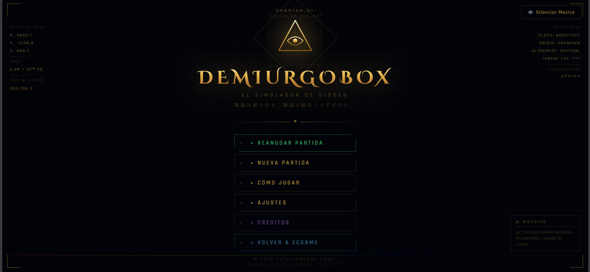
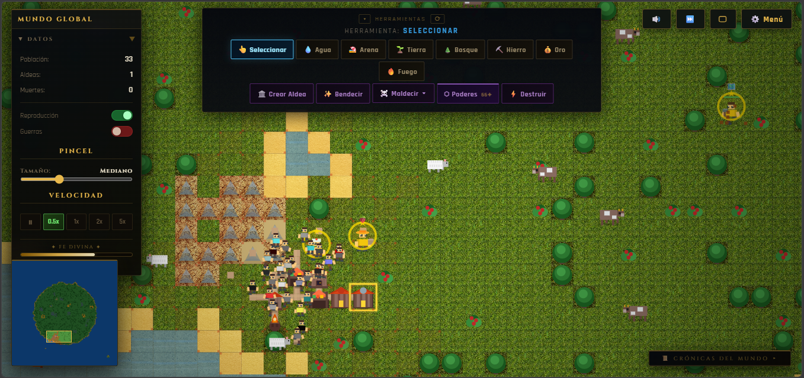

# DEMIURGOBOX

**El Simulador de Dioses**

> 現実は創られる、神話は始まりにすぎない。
> *La realidad se crea, el mito no es más que un comienzo.*

---

## Acerca del juego

DemiurgoBox es un simulador de dioses donde controlas el destino de civilizaciones emergentes. Crea mundos, moldea el terreno, otorga bendiciones o desata tu ira divina sobre tus creaciones.

### Características

- **Creación de mundos** — Genera mundos aleatorios con diferentes geografías (Pangea, Archipiélago, Anillo, Continentes, Desierto, Volcánico, Tundra)
- **Climas dinámicos** — Templado, Tropical, Árido, Frío, Tormenta, Volcánico, Plaga, Bendecido
- **Poderes divinos** — Invoca pueblos, lanza rayos, derrama lluvia de fuego, envía plagas
- **Maldiciones** — Apocalipsis Zombi, Guerra Civil, Gran Hambruna, Locura Colectiva, Lluvia de Meteoros
- **Civilizaciones vivas** — Aldeanos con personalidades, roles, necesidades y relaciones
- **Héroes y épicas** — Guerreros legendarios que emergen cuando tu civilización crece
- **Sistema de edades** — De la Edad de Piedra a la Edad de Oro
- **Pixel art 16×16** — Terreno, props y unidades sobre un atlas propio (CC0), con densidad de pantalla retina
- **Música MP3** — Banda sonora para menú y juego
- **Controles táctiles** — Juega en móvil con touch

## Capturas





## Controles

| Acción | PC | Móvil |
|--------|-----|-------|
| Aplicar poder | Clic izquierdo | Toque |
| Mover cámara | Clic derecho + arrastrar | 2 dedos arrastrar |
| Zoom | Rueda del ratón | Pinch |
| Dibujar terreno | Clic + arrastrar | Arrastrar (1 dedo) |
| Ver info | Hover | Toque largo |

## Jugar online

🎮 **[Prueba el juego aquí](https://nicotips27.github.io/Demiurgo-box/)** — sin instalación, directo en tu navegador.

## Cómo jugar

**En línea** (se publica solo en cada push a `main`):

🎮 **[Prueba el juego aquí](https://nicotips27.github.io/Demiurgo-box/)**

**En local**:

```bash
npm install
npm run dev        # http://localhost:3000
```

El juego está escrito en TypeScript y se compila con Vite, así que **no se
puede abrir `index.html` directamente** desde el disco: hay que usar
`npm run dev` (desarrollo) o `npm run build` (producción, genera `dist/`).

### Despliegue

`.github/workflows/deploy.yml` compila y publica en GitHub Pages en cada push
a `main`. La fuente de Pages está en modo **GitHub Actions**, no en la rama.


### Poderes disponibles

- **Invoke** — Invoca un nuevo pueblo
- **Smite** — Lanza un rayo destructor
- **Rain of Fire** — Lluvia de fuego sobre el terreno
- **Flood** — Inunda una zona
- **Heal** — Cura a los aldeanos cercanos
- **Prosperity** — Otorga recursos a un pueblo

## Tecnologías

- **TypeScript + Vite** — el juego vive en `src/` como módulos ES
- **HTML5 Canvas**
- **Web Audio API** (efectos de sonido procedurales)
- **MP3** (música de fondo)
- **Texturas JPG** (CC0 de OpenGameArt)

## Arquitectura del código

El juego usado ser un único `<script>` inline de 5.244 líneas dentro de
`index.html`. Ahora está dividido en módulos bajo `src/`:

```
src/
├── main.ts              punto de entrada (importa todo, arranca el juego)
├── core/
│   ├── state.ts         TODO el estado mutable del juego, en el objeto `G`
│   ├── constants.ts     constantes (reconciliadas con el juego real)
│   ├── types.ts         enums e interfaces compartidos
│   ├── dom.ts           canvas, contexto y viewport (devicePixelRatio)
│   ├── globals.d.ts     globals del navegador que el juego usa
│   ├── storage.ts       guardado / carga de partida
│   └── loop.ts          bucle principal
├── entities/            Tile · Village · Human · Animal · Fish
├── systems/             worldgen · sim · faith · power · particles · combat
├── render/              atlas · terrain · renderer · minimap
├── ui/                  input · modals · modal-utils · misc · window-bridge
├── audio/               sfx · music
└── utils/               helpers
```

Regla de oro: **no hay variables mutables a nivel de módulo** fuera de
`core/state.ts`. Todo el estado compartido vive en `G` (`G.grid`, `G.humans`,
`G.camX`, …), lo que mantiene el grafo de dependencias sin ciclos.

### Tamaño de tile

El mundo usa tiles de **16 px** (`TILE_SIZE`), que es el tamaño nativo del
pixel art. Los edificios y las unidades se dibujan en un espacio de 20 px
(`LEGACY_TILE`) y se escalan con `ART_SCALE` para encajar en el tile, así que
las proporciones del arte original se conservan.


### Verificación

| Comando | Qué hace |
|---------|----------|
| `npm run typecheck` | `tsc --noEmit` sobre todo `src/` |
| `npm run smoke` | construye, arranca el juego en Edge headless, lo lleva a un mundo vivo, captura errores y dos capturas de pantalla (`smoke.png` con HUD, `smoke-world.png` sin HUD) |
| `npm run test:needs` | prueba headless del sistema de necesidades: simula tres aldeas y comprueba que una aldea con una granja por vecino se alimenta, que una sin granjeas se queda sin comida y que un humano sin comer muere de hambre |
| `npm run parity` | compara los módulos actuales contra el monolito original (recuperado de git) y lista toda diferencia. A partir de la fase 1 la diferencia **crece a propósito**: es la medida de cuánto se ha modernoizado el juego |
| `npm run verify:moved` | comprueba que los bloques que cambiaron de sitio siguen teniendo los mismos valores |
| `npm run build:atlas` | recompone `public/assets/world-atlas.png` a partir de los packs CC0 de origen |
| `npm run shot <url> <out.png>` | captura cualquier página local con Edge headless (sirve para revisar arte) |
| `npm run split:legacy` | ⚠️ regenera `src/` desde el monolito original. **Destruye el trabajo posterior a la fase 0**; solo para auditoría histórica |

> Nota: el TypeScript de este entorno no infiere las propiedades de clase a
> partir de las asignaciones del constructor, así que cada campo está
> declarado explícitamente en las entidades.

## Sistema de necesidades

La comida es un **recurso communal**: la aldea tiene un depósito (`food`) y
cada aldeano tiene que comer de él.

| Comida | De dónde sale | Para quién |
|--------|---------------|-----------|
| Granja | +24 por granja cada 3600 ticks | el depósito |
| Bayas | +30 al recolectar | mitad al aldeano, mitad al depósito |
| Caza | +50 | mitad y mitad |
| Pesca | +30 | 60% al aldeano |
| Depósito | −12 por ración | al aldeano que come |

- El hambre baja 0,005 por tick (la mitad en menores de 15 años). A 0, el
  aldeano pierde 1 de vida por tick y muere de hambre.
- Una granja alimenta a algo más de un vecino; sin granjas el depósito se
  vacía, la estabilidad baja y la aldea se rompe.
- Los aldeanos que se alejan al agua **nadan a la orilla** en vez de ahogarse.

Contadores en `G.foodStats` y `G.deathCauses` (por causa de muerte), y el
Panel de la aldea muestra el depósito de comida.


## Arte

Todo el pixel art se carga desde un único atlas,
`public/assets/world-atlas.png`, con su manifiesto `world-atlas.json`
(nombre → rectángulo). El atlas se genera con `npm run build:atlas` a partir
de estos packs **CC0**:

- **Top Down Asset Pack 1.0** — Ishtar Pixels — <https://opengameart.org/content/top-down-asset-pack-10>
  (hierba, tierra, piedra, árboles, rocas, setas, gemas, aldeanos, zombis)
- **16x16 tileset: water, grass and sand** — Demetrius —
  <https://opengameart.org/content/16x16-tileset-water-grass-and-sand>
  (agua animada y transiciones de costa)

Los assets de Super WorldBox son de Maxim Karpenko y están bajo copyright:
aquí se replica su **estilo** (pixel art de 16px, sombras suaves, contorno
oscuro), nunca sus archivos.


## Créditos

- **Pixel art del mundo**: [Top Down Asset Pack 1.0](https://opengameart.org/content/top-down-asset-pack-10) de Ishtar Pixels (CC0) y [16x16 tileset: water, grass and sand](https://opengameart.org/content/16x16-tileset-water-grass-and-sand) de Demetrius (CC0)
- **Terreno (fotos, pack anterior)**: [Terrain textures pack from Stunt Rally 2.3](https://opengameart.org/content/terrain-textures-pack-from-stunt-rally-23) por CryHam (CC0)
- **Música**: Archivos MP3 propios
- **Desarrollo**: Estalingrado Corp. 2026

## Licencia

El código del juego es propietario.
Los packs de pixel art citados están bajo **CC0** (dominio público).

---

*现实は創される、神話は始まりにすぎない。*
